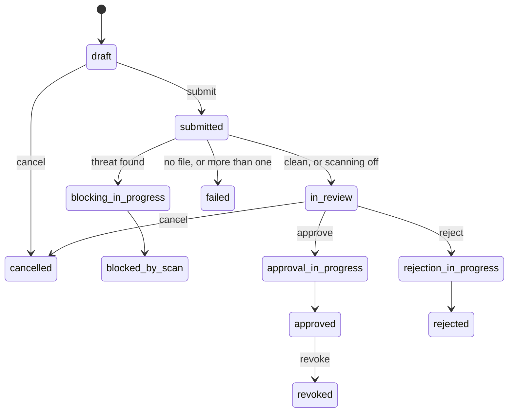

# Airlock

The airlock is the only sanctioned way to move files into or out of a workspace. It follows
AzureTRE's airlock: a researcher creates a request, uploads one file and submits it. The file
can be scanned for malware. An airlock manager reviews it, in a review VM if needed, and
approves or rejects it. The requester and the workspace are told by email at each step.

The UI is AzureTRE's own: workspaces report `enable_airlock: true` and the API implements
AzureTRE's airlock endpoints, so the **Airlock** pages work as they do in AzureTRE.

## Requests and their stages

| Who | Can |
|---|---|
| Workspace owners and researchers | create, upload to their draft, submit, cancel, download approved files |
| Airlock managers | read the file in review, create a review VM, approve, reject, revoke approved requests |

Each request is an `AirlockRequest` resource in the workspace's namespace. The API records
what users do, and the KubeTRE controller does the rest: it seals the file on submission,
waits for the malware scan, moves the file when it is approved, deletes it when the request is
cancelled or rejected, and sends the emails. There is no Service Bus, Event Grid or Azure
Functions app.

## Storage

AzureTRE has moved from a storage account per stage, ten or more for the TRE plus five per
workspace, to two shared accounts. KubeTRE starts with the newer design:

| Account | Reachable from | Holds |
|---|---|---|
| External, `stalext<name>` | the internet, limited to `gateway_source_ranges` and the TRE's firewall | import drafts, imports in review, approved exports |
| Internal, `stalint<name>` | only inside the TRE, through one private endpoint | export drafts, exports in review, approved imports |

Each request has its own containers: `<id>-draft` while the requester uploads, and `<id>`
once it is sealed. The stage is kept on the `AirlockRequest`, so data is copied only twice:
when it is sealed on submission, and when it is approved and crosses between accounts.

Both accounts have shared keys turned off. Every link is a **user delegation SAS**, signed with
Entra ID by the airlock identity, scoped to one container and valid for one hour. Links follow
AzureTRE's rules:

| Status | Link | Who |
|---|---|---|
| draft | read, write, list, delete | the workspace's owners and researchers |
| in review | read and list | airlock managers |
| approved | read and list | the workspace's owners and researchers |
| any other | none | |

A sealed file cannot be changed: the draft container is deleted when the request is
submitted, so the draft link stops working.

## Import

1. A researcher creates an import request. Its draft container is on the **external** account.
2. They upload the file from their own computer, with the link from the UI.
3. They submit. The controller seals the file, waits for its scan, and moves the request to
   in review.
4. An airlock manager reads it with a link, or creates a review VM in the
   [Airlock Import Review workspace](../templates/workspaces/airlock-import-review.md), which
   can reach the external account and nothing else.
5. On approval the file is copied to the **internal** account. Researchers download it from
   their workspace VMs, through the private endpoint.

## Export

1. A researcher creates an export request. Its draft container is on the **internal**
   account, and they upload from a workspace VM.
2. They submit. The file is sealed and scanned as for an import.
3. An airlock manager reviews it, if needed in a review VM in the same workspace.
4. On approval the file is copied to the **external** account, where the researcher
   downloads it from outside the TRE.

## Malware scanning

With `airlock_malware_scanning_enabled`, Microsoft Defender for Storage scans every file
uploaded to either account and tags it with the result. The controller holds a submitted
request until its file has a result: `No threats found` moves it to review, anything else
blocks it. Scanning is billed per GB scanned, capped by `airlock_malware_scanning_cap_gb`.

Without scanning, submitted requests go straight to review.

## Review VMs

An airlock manager can create a review VM from the request's page. KubeTRE creates it from
the template named in the workspace's review settings, owned by the manager, with a read-only
link to the request's file valid for eight hours:

- **Linux** VMs have the link and instructions in `~/airlock/` in the manager's home.
- **Windows** VMs receive the link as custom data, in `C:\AzureData\CustomData.bin`.

Each manager can have one healthy review VM per request. Review VMs are removed when the
request is approved, rejected or cancelled.

Imports are reviewed in the TRE's Airlock Import Review workspace, exports in the workspace
itself. See [Airlock administration](../admin/airlock.md) for the settings.

## Notifications

When the platform has an SMTP server configured, the controller emails:

| Status | Recipients |
|---|---|
| in review | the workspace's airlock managers |
| approved, revoked | the workspace's owners and researchers, and the requester |
| rejected, blocked, failed | the requester |

Each email links to the request in the UI. Each status is sent once, even when the controller
restarts.

## How this differs from AzureTRE

- **One private endpoint.** AzureTRE gives each workspace its own private endpoint to the
  internal account, with attribute-based access conditions limiting it to that workspace's
  containers. KubeTRE has one private endpoint that every airlock workspace's VMs reach.
  Requests are separated by their links, each scoped to one container, rather than by the
  network. Add workspace endpoints and conditions before relying on the network boundary
  between workspaces.
- **One signer.** AzureTRE signs links with each workspace's Entra application. KubeTRE has no
  per-workspace applications ([ADR 3](../adr/0003-identity.md)); the API signs with the
  airlock identity, after checking the caller's workspace role.
- **History in the resource.** A request's history and reviews are kept on its
  `AirlockRequest`, not in Cosmos DB. They are deleted with the workspace.
- **Email over SMTP.** AzureTRE sends email through a Logic App. KubeTRE sends it directly,
  through any SMTP server, such as Azure Communication Services.
